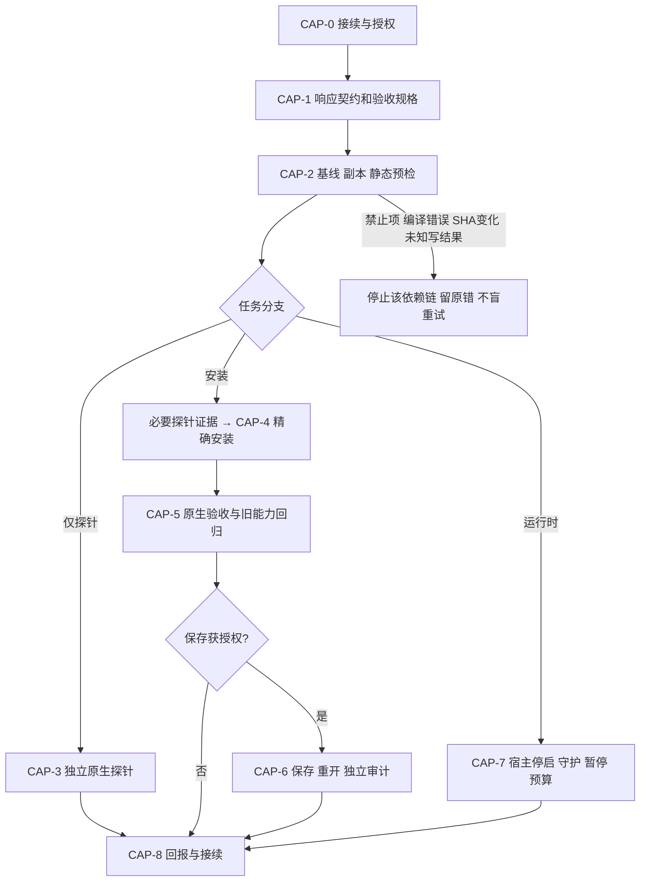

# AD26 MCP 能力移植与验收 Pipeline v1.0

本流程把两段对话中已验证的做法收敛为可复用子流程。用于新 API 探针、AD22→AD26 移植、已有能力修复、安装验收、宿主运行时验证；只读日志分析也走相应分支。它接入 AD设计流水线项目总控，不另建产品设计门禁，不把工具能力通过当成符号库发布、PCB同步或制造交付通过。

本文件为发布导出件。使用者的项目权威基线须在自己环境维护。当前版本/路径/SHA/已验范围以 [本机环境准备](setup.md)、[项目接续约定](../templates/continuation.md) 和当前受控清单为准。本文不固定 PID、session_id、测试对象数或“最新能力数”。2026-11-25 的47能力与M8探针只是历史落点，不能作为下轮实时状态。

## 1. 输入、输出和四种任务分支

开始前填任务包：[任务模板](../templates/task.json)。模板是被动数据，不是可直接执行的命令脚本；占位值必须按授权填齐。

最小输入：任务ID、最新指令及修订号、任务分支、目标能力、允许修改文件、交付件路径/大小/SHA、被保护的真实资产、允许操作的测试副本、精确调用参数、必需键/期望值/有效阴性、保存许可、回滚基线、报告路径。

最小输出：原始请求与完整响应、编译原错、逐条keys_ok/values_ok/verdict、前后SHA、宿主/文档证据、已验边界、回滚记录、报告与接续信息。

| 分支 | 走到哪里 | 不得推导出的结论 |
|---|---|---|
| readonly_inventory | CAP-0/1 → 离线取证 → CAP-8 | 不把截断日志补成完整schema，不调用命令补历史 |
| probe_only | CAP-0 → 1 → 2 → 3 → 8 | 探针通过不等于生产命令已安装或持久化已验 |
| install_acceptance | CAP-0 → 1 → 2 → 必要的3 → 4 → 5 → 8 | 已有同SHA、同前提的探针不重跑；不擅自进入保存 |
| runtime_closure | CAP-0/1/2 → 7 → 8 | 宿主守护恢复不等于AD进程崩溃、重启操作系统后均可自愈 |

CAP-6只在任务明确授权保存/重开时执行。CAP-7只在运行时行为改变或任务要求收口时执行。已有验收证据的复用必须匹配源码SHA、接口、前提和规格；不机械重做全部历史切片。

## 2. 阶段门禁

| 阶段 | 执行内容 | 放行证据 |
|---|---|---|
| CAP-0 接续 | 读AGENTS、SUPERVISOR-CORRECTION、资产登记、经验库F节、协作约定、current-state及最新执行单；旧指令不覆盖新修订 | 授权范围、真实资产、可改文件、已验切片和当前动作明确；无冲突待决 |
| CAP-1 契约 | 从原始响应/权威源码列参数与两层键；区分必需键、允许空数组、阴性和拒绝码；把基线统计写成任务输入 | 每个case有request、前提、required_keys、期望、判定规则；不凭名称补字段 |
| CAP-2 基线 | 核固定profile及整套SHA；Win32进程+EnumWindows；核宿主/活动文档/已加载文档；按授权准备TEMP副本；跑check_pitfalls及适用契约测试 | 指纹精确；真实资产及副本SHA已记录；forbidden=0；warn逐条判断；测试对象路径能回读确认 |
| CAP-3 探针 | 优先复用现成、核SHA的最小独立工程；确认文档聚焦；维护时防守护误恢复，正常停MCP并确认session_end再RunScript | 新鲜原始输出或首个完整编译错误；对象前提已证明；不靠launcher退出推断探针成功 |
| CAP-4 安装 | 使用批准交付件原字节覆盖指定文件；新pas需PrjScr登记；profile/client/release成套同步；按授权是否升revision；单次受认可派发 | 落地大小/SHA/编码/尾部与交付一致；仅授权文件变化；新session_start+first_tick及独立ping/version一致 |
| CAP-5 验收 | 按精确顺序/焦点分组跑正向、负向、limit、guard和跨命令互证；必要写后立即还原，再独立读回；旧能力同对象基线回归 | 先核键再比值；逐条原始响应；前后SHA；新能力可用且受影响旧能力未回归 |
| CAP-6 持久化 | 仅在授权的明确测试副本上保存指定文档，独立磁盘结构审计，原生重开回读 | 保存前后语义符合预期，文件/对象/网络/引脚/焊盘均按任务核对；不从“保存成功”推断内容正确 |
| CAP-7 运行时 | 按下节闭环验证宿主入口、停机、pause、守护、幂等、预算、清理；不注入未授权崩溃 | 前后身份一致、首次失败到恢复的实测时间、恢复后最小业务读数、无第二持久宿主、无遗留守护 |
| CAP-8 收口 | 写报告、清单、范围、回滚和current-state；登记可复用资产；业务任务另做自己的G门禁 | 精确状态与证据可追溯；下轮知道从哪继续，不沿用缓存PID或重放旧写请求 |

静态预检命令：`python <CHECK_PITFALLS_PY> <待运行文件...>`。退出0才可能放行；1禁止运行；2是检查失效，不能当通过。warn允许继续与否由真实上下文决定，不以数量自动判成功。

## 3. 安装的成套一致性检查

1. 先记录生产文件与profile/client/release/manifest的旧SHA、备份路径；保留真实资产和测试副本SHA。
2. 核交付件大小、完整SHA、实际编码、CRLF/裸LF、NUL/替换字符、尾换行；不自行格式化或转码。
3. 查重复函数、前置声明顺序、顶层结构平衡、局部调用和SDK覆盖；新函数只被ping间接加载不等于其全部分支可编译执行。
4. 维护前确认守护状态。需要停MCP/跑独立脚本时，按授权暂停守护或确认其未运行；不要让守护与RunScript争用引擎。已有pause文件是用户状态，不擅自删除；只清理本任务自己创建且已完成用途的pause。
5. 正常停准确会话并确认session_end，再原样安装指定文件。必须进入PrjScr的新pas先有正确Document登记；没改的脚本也核SHA不变。
6. profile.files的candidate_sha256与实装对应；capabilities增删及顺序与client expected_caps、release一致；重算release.profile_sha256。source_sha256只按本轮发布字段约定改，不猜其语义。
7. revision只有明确授权才升；能力扩展不自动升revision。manifest将原生文件与宿主工具分开列。
8. 只走当前受认可入口派发；等待本次新增session_start、first_tick，再握手。原生ping没有capabilities字段时，只能分别报告ping原文和受控profile/client/release能力证明，不能给ping补字段；若任务强制要求该缺失字段，说明规格冲突。

原生编译报错时不重试、不改监督交付源码、不用IDE编译掩盖；保留文件/行号/标识符。按本轮预先批准的策略做磁盘回滚；调试暂停的宿主恢复另按授权处理，不能因为回滚了文件就宣称运行期恢复。

## 4. 参数、焦点、响应的固定纪律

- 共享ASCII门禁只约束入站参数。中文出站必须由服务端正确转义并能被标准JSON解析；两者不能混为一谈。不用Latin-1伪装、手写Unicode转义等办法绕过门禁。
- 中文路径若没有已验证参数文件入口，先做参数面设计：例如active查询聚焦中文文档，doc路径验收用已授权的ASCII命名文档。两组按各自基线比，不能仍用另一文档的计数。
- 原生文档切换只用本轮获准且已验证的方式，回读精确路径；不因长/短路径可能指向同一文件就假定AD按同名加载的是同一实例。8.3短名也可能含中文。
- PcbLib路径不匹配而返回PCBLIB_NOT_FOCUSED属于已定义边界；先按规格切焦点，不能擅自改handler抢焦点。SchLib和PcbLib验收按组切焦点。
- “工程里列出文档”和“编辑器已加载文档”分开记录。NOT_LOADED时是否允许打开由任务决定；有“不得为跑通加载”的限制就原样报，不补操作。
- 每条成功响应先核必需键，十个数组即使为空也必须在；拒绝响应核error封套，不能要求错误响应长出成功data。缺键不当false，空数组不当逐对象字段已实证。
- counts表示完整统计，数组长度受limit约束，truncated按所有受限kind判断；不把数组长度当总数，也不把“count=0”自动当错误。
- 规格修订只复判保存的原始响应并记录旧/新判据；禁止把规格修订伪装为代码修复。层级根图components=0而含层级符号就是本项目实例。
- 活动查询返回来源_doc/doc；跨命令比较相同测试文档、同会话语义。不跨重载会话硬比UniqueId。
- activity.log可能只保留200字符前缀。响应声明字节数不是保留字节数；完整JSON/全部键/数组项数不可由截断片段推造。应立即保存真实response_<id>.json和请求参数；历史已丢失就报partial。

## 5. 宿主守护的固定验收闭环

独立脚本探针不与本节并发。正常入口由manifest.entry.sanctioned声明；ForceRestart为监督恢复钩子，deprecated工程不得用于日常启动。

1. 记录基线ping/version、47之类的实际能力列表和宿主PID，不把历史能力数固定为期望。
2. 活服务`supervisor.py --once`只探测、不重启，成功0/probe_ok。
3. 正常stop后建pause；once返回0/paused，没有请求与restart_begin；再直接exchange ping应超时。不要用会自动连接的handshake充当停机负向证据。
4. 删除自己创建的pause，后台按任务参数启动守护，只观察日志，60s或任务规定期限内不从控制端手工拉起。记录probe_fail→restart_begin→restart_result→probe_ok。
5. 恢复后检查相同宿主、revision/protocol/cast_errors、能力清单和最小业务读数；瞬态转发器回收与“第二持久AD宿主”分开证明。
6. max-restarts用满N次后立即budget_exhausted并退出，不继续探测。once失败返回1也永不ensure_connected；pause时once只一行paused。
7. 收尾pause once、删本任务pause、核无遗留守护；测恢复耗时按首次probe_fail至首次probe_ok，保留时间单位与时区。
8. release区分in-AD fail-closed、手动宿主停启和host_watchdog恢复；autostart_verified沿用其被证明的含义。优雅stop恢复不能自动升级成native崩溃/断点/模态框/AD退出恢复。

守护默认预算、无OS自启动、未实测故障种类、慢调用超时误判、日志轮转和未知写结果均写进残余风险。不能把当前没有守护进程说成“正在受守护长期运行”。

## 6. 失败分流与状态

| 事件 | 处理 | 不得做 |
|---|---|---|
| 真实文件SHA改变 | 最高优先级停止，列前后差异、实际触发与授权范围 | 继续执行来凑验收 |
| 编译错/断点/Another script executing | 留完整首错，停止后续原生派发，按现有授权恢复 | 第三次盲试、推断后续API缺失、擅自强杀 |
| 写请求超时/结果未知 | 保留请求ID及未决状态，先核对象和检查点 | 自动重发、用守护恢复掩盖未知写 |
| 门禁拦截/缺必需前提 | 记录派发前拒绝或前提缺失，做独立不依赖它的工作 | 放宽门禁、写入真实工程、改试验对象伪装同一用例 |
| 有效阴性/Nil/空数组 | 按任务期望判读；未取样与接口不存在分开 | 擅自改探针、换字段重试 |
| 必需键缺失/值不符 | 保留完整响应，按任务停止相应依赖链；独立用例仅在授权允许时继续 | 补默认值、凑数或反复跑到通过 |
| 宿主重启入口失败 | 记录确切命令、输出、日志、锁和宿主状态；按任务停止 | 再开AD、重复拉起、宣称“恢复已完成” |

执行状态仅attempted/partial/failed/verified。keys_ok与values_ok分别记录；verdict按该用例规格决定，有效阴性可以verified，缺键不能verified。技术探针编译通过而语义未达时可为partial；任务另有精确判定规则时从其规则。

verified必须附scope：probe_compile / probe_runtime_read / probe_runtime_write_unsaved / installed_command / persisted_artifact / host_restart / watchdog_recovery。不同scope不能互相晋级。产品G0–G7通过与否仍由产品交付证据决定。

## 7. 回滚与接续包

回滚前明确是否只回文件、是否有运行期恢复授权。标准一致性顺序：停准确会话→恢复批准备份→profile candidate哈希与能力→client允许集→release能力与profile哈希→外部受认可入口→新日志与握手→受影响能力最小回归。revision和manifest版本指向同步按发布约定核对。不是每轮都执行回滚。

接续包必须回答：当前实际版本/能力与文件SHA；本轮已验scope；未执行/失败项及原因；活动文档和未保存内存修改；守护/pause/未决请求/锁状态；精确证据路径；下一步允许做什么；哪些切片不可重做。状态只按本次证据升级，不缓存旧PID为当前在线事实。

报告正文在Obsidian对应work/reports；port-results是按监督要求交付的执行附件。不要建立第二套正式知识正文。流程变化更新本页版本及原因；事件细节继续留原始报告，不复制成长篇新规范。

## 8. 公开复用边界

使用[验证范围](verification.md)理解历史结论，使用[准备流程](setup.md)建立本机基线。原始日志、真实资产和内部验收附件不在此包中；不得用本仓库文档冒充本机验收。
