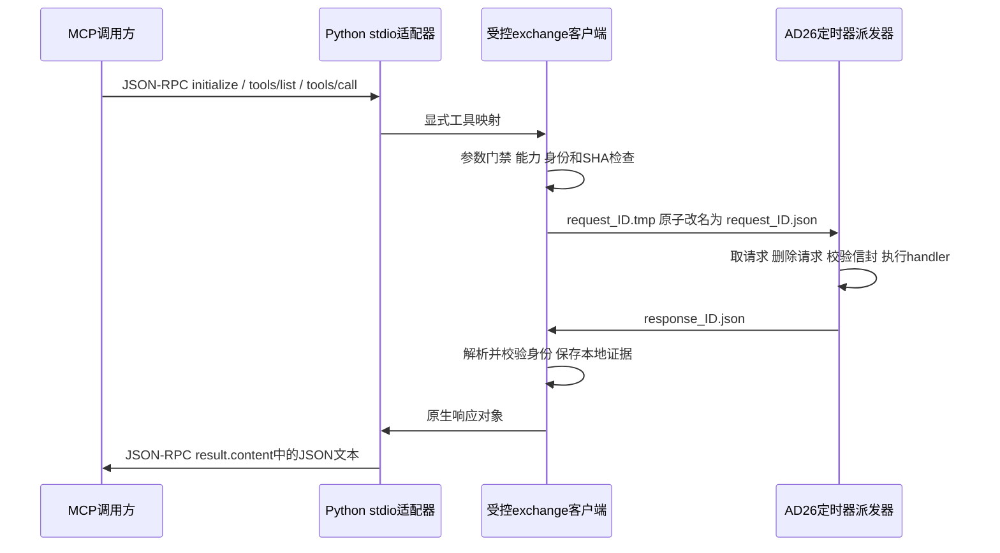

# 三层协议与状态语义

本说明描述所检查的实装，不把局部实现补写成完整标准或认证结论。

## 第一层：stdio MCP适配器

使用逐行JSON-RPC 2.0。所检查客户端处理initialize、ping、tools/list、tools/call；缺id的通知被忽略。initialize实现会回传请求中的protocolVersion，缺省字符串为`2024-11-05`，serverInfo仍带bootstrap历史名称。因此本包**不声称标准MCP全版本兼容或合规认证**。

标准MCP的`ping`仅返回空对象，不等于AD原生`application.ping`。健康工具才进一步核实AD。

该基线tools/list只有下列5项：

| 标准工具 | 原生方向 | 边界 |
|---|---|---|
| ad26_health | application.ping + application.get_version | handshake在停止标记下可能调用宿主连接入口 |
| ad26_stop | application.stop_server | 只停MCP脚本服务，不关闭AD |
| ad26_component_silk_frame | pcb.component_silk_frame | 特定目标PCB，有其独立的写保护与保存语义 |
| ad26_lo_snapshot | lo.snapshot | 需要已配置的受控快照适配器 |
| ad26_lo_sync | lo.sync | 受限计划/测试验收/检查点，不是任意工程全量同步 |

47条清单是Python exchange允许的原生命令，不是对外47个独立工具。要扩展tools/list须另外开发并验收映射，本次没有完成这一层扩展。

## 第二层：Python受控调用

抽象接口形状：`load_profile(path)`、`exchange(profile, command, timeout=12, params=None)`、`handshake(profile)`；宿主启动为`lifecycle.ensure_connected(profile)`。这是对现有接口的说明，不是本包提供的可运行实现。

- profile显式选择实例、候选脚本集、workspace、revision、协议与有序能力集。client允许集、profile及release必须逐项一致；脚本SHA与release.profile_sha256必须对应。
- 所检查客户端含机器绑定路径约束，**不能直接把示例profile交给原客户端就期待跨机器运行**。移植路径校验必须单独得到授权和回归验证。
- 入站params的嵌套字符串和键均须纯ASCII。`json.dumps(ensure_ascii=True)`只是编码方式，不能拿来绕过原值门禁。中文出站可为JSON Unicode转义并由标准解析器还原。
- 只有已登记的作用域文件适配器可以承载其允许的GBK业务内容；不是所有命令都支持参数文件。
- 非成功原生响应通常被exchange抛为RuntimeError；超时为TimeoutError，保留请求ID，不自动重发。原始错误响应应从匹配ID的文件保存。
- handshake可能自动连接，因此停止态负向测试应用不会自动启动的exchange ping；不要用handshake“证明服务仍死”。
- 受控入口拒绝无范围保存、工程保存/更新PCB及运行中MCP再RunScript等调用；这不是每个原生命令都自带完整事务保护的保证。

## 第三层：原生文件IPC信封

请求文件名：`request_<id>.json`。Python先写同目录`.tmp`，再原子rename。id采用32位小写十六进制，每请求独立。示例见[请求](../examples/request.ping.json)。

| 请求字段 | 类型 | 语义 |
|---|---|---|
| protocol_version | integer | 本项目基线26 |
| instance_id | string | 本基线ad26 |
| session_id | string | 候选绑定身份，示例为虚构值 |
| id | string | 每请求关联ID |
| command | string | 点分原生命令名 |
| params | object | 命令专有参数，递归ASCII门禁 |

请求信封没有revision字段；响应包含revision，并由Python对照绑定基线。session_id在这个实现中标识候选，**不保证每次调度器重启生成新UUID**；重启实例需用本次新增日志、PID和握手判断。

响应文件名：`response_<id>.json`。有protocol_version、instance_id、session_id、revision、id、success、data、error。成功时error为null；失败时data为null，error有code/message/details（details可为null）。[成功示例](../examples/response.ping.json)与[拒绝示例](../examples/response.error.json)。

服务端取请求后删除请求再执行。因此超时可能是未处理、已执行但回执迟到或其它未知结果，不是“肯定没做”。旧文件会被启动清理；启动后应等本次session_start和首次tick再发送请求。客户端会重新读取未完成的JSON文件，但不重新执行请求。不要声称服务端响应写入也已经原子化。

原生会核protocol/instance/session。缺失或错误身份、协议不匹配分别可得到IDENTITY_MISMATCH/PROTOCOL_VERSION_MISMATCH等。畸形id可能回落到通用response.json，而标准exchange等待匹配ID，所以不能假设畸形请求总能获得匹配回执。

## 身份、错误和单位

本地文件IPC是可信主机内的控制协议，身份字段和SHA是路由/一致性校验，**不是网络认证或签名**。本包不增加HTTP监听端口，不向公网暴露AD。

错误必须先核error及code存在，再比较值；错误响应不用强求成功data字段。常见码包括NOT_LOADED、MISSING_PARAMS、PATH_GUARD_BLOCKED、INVALID_LAYER、COMPONENT_NOT_FOUND、FOOTPRINT_NOT_FOUND、PCBLIB_NOT_FOCUSED、CONFIRM_REQUIRED；并非每条命令支持全部错误码。

原理图几何和封装pad输出标注mil；generic.query_objects的Location.X/Y原值仍可能是内部坐标。消费者必须读该命令契约，不混用坐标系统。

## generic.get_sch_geometry专有形状

[数据Schema](../schemas/geometry-data.schema.json)描述必需外层键、十种counts和十个数组。counts是完整统计，各数组分别受limit约束，truncated表示有任一种受限kind超出上限，不是只检查wires。

默认limit200。scope支持active/doc；doc需要已加载的明确路径，path_guard是作用域检查，不会替调用方打开文档。入站中文不允许时，active调用只传ASCII scope，出站doc仍可包含Unicode；doc路径验收另选经过批准的ASCII文档并用它自己的计数基线。

sheet_symbols行含index/x/y/width_mils/height_mils，未提供名字/文件名。sheet_entries行含sheet_index/name/io_type/side/x/y。按各数组独立limit截断后，某些入口可能指向未返回的符号；不可以假设任何limit下均能在当前页解析所有关联。线/总线明细只含vertices总数及首尾坐标，并非完整折线顶点序列。

unsupported_kinds必须存在；纯图形对象不在本窄实现内。本包Schema没有为其它八种明细臆造完整元素结构。[合成几何示例](../examples/response.geometry.json)只为离线校验，不能当原生执行证据。
